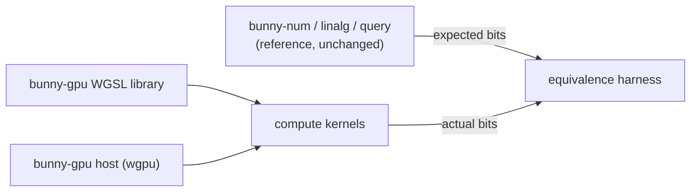

# 0005 — GPU Compute Backend (Proposal)

Status: proposal. Nothing here is implemented. The toolchain claims were checked against
primary sources on 2026-11-13; see [Verified on 2026-11-13](#verified-on-2026-11-13) for
the sources, what was checked by reading rather than by running, and what remains
unverified.

## Purpose

Run Bunny's deterministic math and query kernels on a GPU, with output bits identical to
the CPU crates. The immediate consumer would be a path tracer (lumen) that casts billions
of rays per image; the other motivation is that a bit-exact, cross-vendor GPU backend for
fixed-point geometry would be unusual and worth having.

This is a compute backend for Bunny's math. It does not make Bunny a renderer.

## Why It Can Be Bit-Exact

GPU floating point is not reproducible across vendors or drivers: compilers fuse
multiply-adds, flush denormals and reassociate under fast-math rules. GPU **integer**
arithmetic is different. Addition, subtraction, multiplication, shifts and comparisons on
32-bit integers have exactly specified results in WGSL.[^wgsl-int] This document
verified WGSL only; the same property for SPIR-V, Metal and HLSL is assumed and is not
checked here. Bunny's
canonical math is already integer-only, so a GPU port can reach the same bits as the CPU,
provided every operation it uses is exactly specified (see [risks](#risks)).

## The Main Obstacle: Word Size

Bunny's arithmetic is built on `i64` values and `i128` intermediate products. GPUs are
32-bit machines:

| Target | 64-bit integers | 128-bit integers |
| --- | --- | --- |
| WGSL (WebGPU, browsers) | no `i64`/`u64` in the core language;[^wgsl-types] only `i32` and `u32` | no |
| wgpu native (Vulkan, Metal, DX12) | optional, native-only `SHADER_INT64` feature on Vulkan, DX12 (DXC only) and Metal (MSL 2.3+), where the device supports it;[^wgpu-int64] not available in browsers | no |
| Metal Shading Language | `long` / `ulong` (Metal 2.2 and later)[^msl] | no 128-bit type in the scalar type table[^msl] |
| rust-gpu (Rust compiled to SPIR-V) | `i64`/`u64` map to SPIR-V `Int64`, which the Vulkan device must also enable;[^rustgpu] requires a pinned nightly toolchain | `i128` is accepted as a type but the linker rejects 128-bit integer widths, so it is unusable on the GPU side[^rustgpu] |

So every backend must emulate at least the 128-bit products, and the portable WGSL backend
must also emulate 64-bit values as pairs of `u32`. Approximate costs, as estimates:

| Operation | Emulated with `u32` limbs |
| --- | --- |
| Q32.32 add/sub | 2 adds with carry |
| Q32.32 multiply (64×64→128, round, shift) | about 4 `u32` multiplies with high halves, about 10 adds/carries |
| Q32.32 divide | long division in limbs: tens of operations; avoid in hot loops |
| square root | Karatsuba stages on limbs, or a table-seeded reciprocal square root |

Division is the operation to design around. The planned CPU work (one reciprocal reused
for several divisions, inverse ray directions, divide-free normalization) matters even
more on a GPU, where it turns division into multiplication.

## Proposed Shape

A new crate, `bunny-gpu`, outside the core crates:

- **Quarantined.** `CODE_STANDARDS.md` Rule 1 allows platform and `unsafe` code only in a
  backend crate with a safe reference implementation and equivalence tests. The GPU
  library is that crate. The core crates stay unchanged and remain the reference.
- **Shader library.** WGSL functions mirroring `FixedQ32_32` (limb representation,
  `mul`, `checked_div`, `sqrt`), `FixedVec3`, and the ray queries, with the same
  rounding rules (ties to even) and the same handling of overflow (`None` becomes an
  explicit flag).
- **Host API.** A thin `wgpu` wrapper that uploads inputs, dispatches a kernel and reads
  results back as raw `i64`, so tests can compare bits.
- **Equivalence harness.** For every kernel: seeded inputs, CPU results from the core
  crates, GPU results from the shader, and a bit-for-bit comparison; the same golden
  vectors the CPU tests use.

### Choosing the shader route

| Route | For | Against |
| --- | --- | --- |
| WGSL with `u32` limbs | Runs everywhere `wgpu` runs, including browsers. | All 64-bit arithmetic emulated; a second implementation of every function to keep in step with the Rust one. |
| WGSL with `SHADER_INT64` | Native 64-bit values; only the 128-bit products are emulated. | Native targets with 64-bit shader support only; still a second implementation. |
| rust-gpu | The shader could be compiled from Bunny's own Rust, if the `i128` uses are routed through a limb type. | Needs a pinned nightly toolchain and the project describes itself as early-stage;[^rustgpu] `i128` is not available on the GPU side. |

Recommendation: start with **WGSL and `u32` limbs**. It is the most portable and makes
the emulation explicit and testable. Revisit rust-gpu once the arithmetic library exists,
because a single source of truth would remove the biggest maintenance cost.

## Testing Without GPU Hardware In CI

Hosted CI runners have no GPUs. Software implementations (Mesa's lavapipe for Vulkan,
WARP for DX12) run the same shaders on the CPU. `wgpu` can request only a fallback (software) adapter,[^fallback]
and wgpu's own CI installs Mesa (lavapipe) on hosted Ubuntu runners and WARP on Windows
runners.[^ci] Hosted images do not ship a software Vulkan driver by default, so the
workflow must install one.[^image] This was checked in configuration, not by running a
`bunny-gpu` job. Because the backend is integer-only, a software adapter must
produce the same bits as real hardware, so the equivalence tests can run in CI and on
local Apple GPUs (Metal) alike. Speed is measured only on real hardware.

## Milestones

Each milestone is independently useful and mergeable.

1. **Bit-exact arithmetic.** `bunny-gpu` with the WGSL limb library for add, sub, mul,
   div and sqrt; a kernel that evaluates one million seeded inputs; bit equality with
   `bunny-num` on Metal and on a software adapter in CI.
2. **Vectors and queries.** `FixedVec3` operations, ray–AABB, ray–sphere and
   ray–triangle kernels, with the same equivalence harness and golden vectors.
3. **Traversal.** BVH traversal on the GPU (a stackless or short-stack scheme), checked
   against the CPU traversal's hit lists.
4. **Throughput.** A `bunny-perf`-style harness for GPU kernels: rays per second against
   the CPU on the same machine, so the backend's value is measured, not assumed.
5. **Consumer.** A wavefront path-tracing integration in lumen, with images bit-identical
   to the CPU renderer.

## Effort And Payoff (Estimates)

- Milestone 1 is the hardest: designing the limb library and its rounding rules, plus the
  `wgpu` scaffolding. Roughly one to two weeks of focused work.
- Milestones 2 and 3: another two to four weeks, mostly porting and testing.
- Payoff is uncertain. Emulated 64-bit arithmetic costs several 32-bit operations per
  Bunny operation, but a GPU runs thousands of lanes. A 5–20× gain in rays per second over
  an 18-core CPU is plausible for traversal-heavy work; it is an estimate, and milestone 4
  exists to replace it with a measurement.

## Risks

- **Edge cases the shader language leaves to the program.** WGSL defines `i32`/`u32`
  add, subtract and multiply overflow as wrapping modulo 2^32, and shift amounts as the
  count modulo the bit width, so a shift by 32 or more at run time is a shift by
  `count % 32`, not zero. Integer division by zero at run time returns the dividend (and
  remainder by zero returns 0), and is a creation error only for constant operands.[^wgsl-int]
  These are defined but differ from Rust, which panics or returns `None`, so the limb
  library must mask shift counts and never let a zero divisor or `i32::MIN / -1` reach
  the GPU, as the Rust code does.
- **Two implementations.** Every change to a core function needs the matching shader
  change. The shared golden vectors catch drift, but the cost is ongoing.
- **Dependency weight.** `wgpu` is large; keeping it in `bunny-gpu` keeps it out of every
  other Bunny consumer.
- **Driver bugs.** Integer paths are rarely miscompiled, but the equivalence harness is
  the only guard; it must run on every adapter we claim to support.

## Open Questions

- Native-only (`SHADER_INT64`) or browser-capable (`u32` limbs)?
- Does rust-gpu make a single Rust source practical today? It needs a pinned nightly and cannot carry `i128`, so only after the arithmetic library routes every 128-bit value through a limb type.
- Does lumen need the GPU at all, after the CPU division work lands? Measure first.

## Verified on 2026-11-13

Every claim previously marked "verify first" was checked on 2026-11-13. "Read" means the
source text was read; no GPU program was run, and no shader was compiled for this
document.

| Claim | Verdict | Source and version |
| --- | --- | --- |
| WGSL has no 64-bit integers | Confirmed | [^wgsl-types] |
| `SHADER_INT64` exists, native-only, on Vulkan, DX12 (DXC), Metal | Confirmed, with detail added: DX12 needs DXC and Metal needs MSL 2.3+ | [^wgpu-int64] |
| MSL has 64-bit `long`/`ulong`, no 128-bit | Confirmed 64-bit (Metal 2.2+); no 128-bit type is listed (absence in the table) | [^msl] |
| rust-gpu: `Int64` capability | Confirmed by source read | [^rustgpu] |
| rust-gpu: nightly requirement | Confirmed (pinned nightly) | [^rustgpu] |
| rust-gpu: no 128-bit integers on the GPU | Confirmed by source read | [^rustgpu] |
| Software adapters on hosted runners | Partly confirmed: selection API exists and wgpu's CI uses lavapipe and WARP; not run for Bunny | [^fallback], [^ci], [^image] |
| 32-bit add, sub, mul, shift, compare exactly defined | Confirmed for add, sub, mul (wrapping) and shifts (count modulo width); compare read only as listed operators | [^wgsl-int] |

The recommended route (WGSL with `u32` limbs first, revisit rust-gpu later) is unchanged.
The findings add two constraints: `SHADER_INT64` excludes browsers and needs DXC on DX12,
and WGSL shift and division edge cases are defined but not Rust's, so the limb library
must handle them.

Still unverified:

- That a `bunny-gpu` job selects a software adapter on a hosted runner; no workflow was
  run. The wgpu documentation text on the fallback adapter says only that it is "generally"
  a software implementation.
- Whether a hosted macOS runner exposes a Metal device; not checked.
- The SPIR-V, Metal and HLSL integer semantics asserted in the introduction.
- That software adapters give the same bits as hardware; this follows from integer
  determinism but needs the equivalence harness to show it.
- rust-gpu behaviour was read from source at a commit, not built or run.
- The effort and speedup estimates are unchanged estimates.

[^wgsl-types]: W3C, WebGPU Shading Language, Candidate Recommendation Draft of 6 November
    2026 (CRD-WGSL-20261106), section 6.2.5 "Scalar Types": "The scalar types are bool,
    AbstractInt, AbstractFloat, i32, u32, f32, and f16." <https://www.w3.org/TR/WGSL/>,
    accessed 2026-11-13.
[^wgsl-int]: Same WGSL draft. Section 6.2.3 "Integer Types": "Expressions on concrete
    integer types that overflow produce a result that is modulo 2^bitwidth." Section 8.8
    "Arithmetic Expressions": integer `/` by zero evaluates to `e1`, `%` by zero to 0, a
    creation error only for const or override operands. Section 8.10 "Bit Expressions":
    "The number of bits to shift is the value of e2, modulo the bit width of e1", with a
    creation error only for constant counts at or above the width. Accessed 2026-11-13.
[^wgpu-int64]: wgpu 30.0.2, `wgpu::Features::SHADER_INT64`: "Allows shaders to use i64 and
    u64. Supported platforms: Vulkan; DX12 (DXC only); Metal (with MSL 2.3+). This is a
    native only feature." <https://docs.rs/wgpu/latest/wgpu/struct.Features.html> and
    `wgpu-types/src/features.rs` at trunk commit bceb82b (2026-11-13),
    <https://github.com/gfx-rs/wgpu>. Accessed 2026-11-13.
[^msl]: Apple, Metal Shading Language Specification, Version 4.1 (dated 2026-06-04),
    "Scalar Data Types" table: `long`/`int64_t` and `unsigned long`/`ulong`/`uint64_t`, "All
    OS: Metal 2.2 and later". The table lists no 128-bit integer. Section on buffers:
    "In Metal 2.3 and later, Metal supports buffers that contain long or ulong data
    types." <https://developer.apple.com/metal/Metal-Shading-Language-Specification.pdf>,
    accessed 2026-11-13.
[^rustgpu]: Rust-GPU/rust-gpu at commit 60d1e25 (2026-10-27), <https://github.com/Rust-GPU/rust-gpu>,
    read 2026-11-13. `rust-toolchain.toml`: `channel = "nightly-2026-08-15"`. The README
    says the project "is still heavily in development and is at an early stage".
    `crates/rustc_codegen_spirv/src/linker/simple_passes.rs`, `capability_for_int_width`:
    8, 16 and 64 map to `Int8`, `Int16`, `Int64`; 32 needs none; any other width, including
    128, returns `UnsupportedType`. The device must enable the capability. The latest tag
    seen was v0.11.0.
[^fallback]: wgpu `RequestAdapterOptions::force_fallback_adapter`: "Indicates that only a
    fallback adapter can be returned. This is generally a 'software' implementation on the
    system." `wgpu-types/src/adapter.rs` at commit bceb82b, accessed 2026-11-13.
[^ci]: gfx-rs/wgpu `.github/workflows/ci.yml` at commit bceb82b: matrix jobs on
    `ubuntu-26.04` run the "Install Mesa" action (Mesa 26.2.6 build); Windows jobs run
    "Install WARP". <https://github.com/gfx-rs/wgpu>, accessed 2026-11-13.
[^image]: actions/runner-images, Ubuntu 24.04 image 20261111.370.1 software list: no
    `mesa-vulkan-drivers` entry.
    <https://github.com/actions/runner-images/blob/main/images/ubuntu/Ubuntu2404-Readme.md>,
    accessed 2026-11-13. The page was read through a summarizing fetch tool, so treat this
    absence as indicative.
