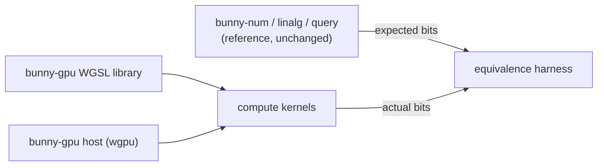

# 0005 — GPU Compute Backend (Proposal)

Status: proposal. Nothing here is implemented. Claims marked **verify first** describe the
state of GPU toolchains from memory and must be checked against current documentation
before work starts.

## Purpose

Run Bunny's deterministic math and query kernels on a GPU, with output bits identical to
the CPU crates. The immediate consumer would be a path tracer (lumen) that casts billions
of rays per image; the other motivation is that a bit-exact, cross-vendor GPU backend for
fixed-point geometry would be unusual and worth having.

This is a compute backend for Bunny's math. It does not make Bunny a renderer.

## Why It Can Be Bit-Exact

GPU floating point is not reproducible across vendors or drivers: compilers fuse
multiply-adds, flush denormals and reassociate under fast-math rules. GPU **integer**
arithmetic is different. Addition, subtraction, multiplication, shifts and comparisons on
32-bit integers have exactly specified results in WGSL, SPIR-V, Metal and HLSL. Bunny's
canonical math is already integer-only, so a GPU port can reach the same bits as the CPU,
provided every operation it uses is exactly specified (see [risks](#risks)).

## The Main Obstacle: Word Size

Bunny's arithmetic is built on `i64` values and `i128` intermediate products. GPUs are
32-bit machines:

| Target | 64-bit integers | 128-bit integers |
| --- | --- | --- |
| WGSL (WebGPU, browsers) | not in the core language (**verify first**) | no |
| wgpu native (Vulkan, Metal, DX12) | optional `SHADER_INT64` feature on supporting hardware (**verify first**) | no |
| Metal Shading Language | `long` / `ulong` | no |
| rust-gpu (Rust compiled to SPIR-V) | with the `Int64` capability (**verify first**) | no (**verify first**) |

So every backend must emulate at least the 128-bit products, and the portable WGSL backend
must also emulate 64-bit values as pairs of `u32`. Approximate costs, as estimates:

| Operation | Emulated with `u32` limbs |
| --- | --- |
| Q32.32 add/sub | 2 adds with carry |
| Q32.32 multiply (64×64→128, round, shift) | about 4 `u32` multiplies with high halves, about 10 adds/carries |
| Q32.32 divide | long division in limbs: tens of operations; avoid in hot loops |
| square root | Karatsuba stages on limbs, or a table-seeded reciprocal square root |

Division is the operation to design around. The planned CPU work (one reciprocal reused
for several divisions, inverse ray directions, divide-free normalization) matters even
more on a GPU, where it turns division into multiplication.

## Proposed Shape

A new crate, `bunny-gpu`, outside the core crates:

- **Quarantined.** `CODE_STANDARDS.md` Rule 1 allows platform and `unsafe` code only in a
  backend crate with a safe reference implementation and equivalence tests. The GPU
  library is that crate. The core crates stay unchanged and remain the reference.
- **Shader library.** WGSL functions mirroring `FixedQ32_32` (limb representation,
  `mul`, `checked_div`, `sqrt`), `FixedVec3`, and the ray queries, with the same
  rounding rules (ties to even) and the same handling of overflow (`None` becomes an
  explicit flag).
- **Host API.** A thin `wgpu` wrapper that uploads inputs, dispatches a kernel and reads
  results back as raw `i64`, so tests can compare bits.
- **Equivalence harness.** For every kernel: seeded inputs, CPU results from the core
  crates, GPU results from the shader, and a bit-for-bit comparison; the same golden
  vectors the CPU tests use.

### Choosing the shader route

| Route | For | Against |
| --- | --- | --- |
| WGSL with `u32` limbs | Runs everywhere `wgpu` runs, including browsers. | All 64-bit arithmetic emulated; a second implementation of every function to keep in step with the Rust one. |
| WGSL with `SHADER_INT64` | Native 64-bit values; only the 128-bit products are emulated. | Native targets with 64-bit shader support only; still a second implementation. |
| rust-gpu | The shader could be compiled from Bunny's own Rust, if the `i128` uses are routed through a limb type. | Toolchain maturity and nightly requirements need checking (**verify first**); `i128` is not available on the GPU side. |

Recommendation: start with **WGSL and `u32` limbs**. It is the most portable and makes
the emulation explicit and testable. Revisit rust-gpu once the arithmetic library exists,
because a single source of truth would remove the biggest maintenance cost.

## Testing Without GPU Hardware In CI

Hosted CI runners have no GPUs. Software implementations (Mesa's lavapipe for Vulkan,
WARP for DX12) run the same shaders on the CPU (**verify first** that `wgpu` can select
them on the hosted runners). Because the backend is integer-only, a software adapter must
produce the same bits as real hardware, so the equivalence tests can run in CI and on
local Apple GPUs (Metal) alike. Speed is measured only on real hardware.

## Milestones

Each milestone is independently useful and mergeable.

1. **Bit-exact arithmetic.** `bunny-gpu` with the WGSL limb library for add, sub, mul,
   div and sqrt; a kernel that evaluates one million seeded inputs; bit equality with
   `bunny-num` on Metal and on a software adapter in CI.
2. **Vectors and queries.** `FixedVec3` operations, ray–AABB, ray–sphere and
   ray–triangle kernels, with the same equivalence harness and golden vectors.
3. **Traversal.** BVH traversal on the GPU (a stackless or short-stack scheme), checked
   against the CPU traversal's hit lists.
4. **Throughput.** A `bunny-perf`-style harness for GPU kernels: rays per second against
   the CPU on the same machine, so the backend's value is measured, not assumed.
5. **Consumer.** A wavefront path-tracing integration in lumen, with images bit-identical
   to the CPU renderer.

## Effort And Payoff (Estimates)

- Milestone 1 is the hardest: designing the limb library and its rounding rules, plus the
  `wgpu` scaffolding. Roughly one to two weeks of focused work.
- Milestones 2 and 3: another two to four weeks, mostly porting and testing.
- Payoff is uncertain. Emulated 64-bit arithmetic costs several 32-bit operations per
  Bunny operation, but a GPU runs thousands of lanes. A 5–20× gain in rays per second over
  an 18-core CPU is plausible for traversal-heavy work; it is an estimate, and milestone 4
  exists to replace it with a measurement.

## Risks

- **Undefined or implementation-defined shader behaviour.** Shift amounts at or above the
  bit width, signed overflow, and division by zero must never reach the GPU; the limb
  library must define them explicitly, as the Rust code does.
- **Two implementations.** Every change to a core function needs the matching shader
  change. The shared golden vectors catch drift, but the cost is ongoing.
- **Dependency weight.** `wgpu` is large; keeping it in `bunny-gpu` keeps it out of every
  other Bunny consumer.
- **Driver bugs.** Integer paths are rarely miscompiled, but the equivalence harness is
  the only guard; it must run on every adapter we claim to support.

## Open Questions

- Native-only (`SHADER_INT64`) or browser-capable (`u32` limbs)?
- Does rust-gpu make a single Rust source practical today?
- Does lumen need the GPU at all, after the CPU division work lands? Measure first.
